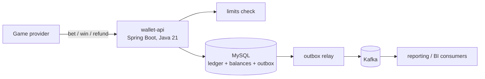

# wallet-ledger

A player wallet and append-only ledger service for real-money platforms (iGaming, payments). It handles bets, wins and refunds from external game providers safely under concurrency and retries, and enforces responsible gaming limits in real time.

> Status: in development.

## Problems it solves

| Problem | Approach |
|---|---|
| Two bets hit the same wallet at once | Atomic conditional update in MySQL, no read-modify-write in Java |
| Providers retry the same request | Idempotency key: unique `(provider, provider_tx_id)`; a retry returns the original result |
| Money must be auditable | Append-only ledger; balance changes in the same transaction as the ledger row |
| Floating point errors | Amounts stored as integer minor units |
| Loss and deposit limits | Checked synchronously before every debit, fail closed, lower immediately, raise after cooling-off |
| Downstream systems need events | Transactional outbox, relayed to Kafka |

## Architecture

## API (planned)

| Method | Path | Purpose |
|---|---|---|
| POST | `/wallets/{playerId}/bets` | Debit a bet (idempotent) |
| POST | `/wallets/{playerId}/wins` | Credit a win for a round |
| POST | `/wallets/{playerId}/refunds` | Roll back a bet |
| GET | `/wallets/{playerId}` | Balances per wallet (real, bonus) |
| PUT | `/players/{playerId}/limits` | Set deposit / loss limits |

## Stack

Java 21, Spring Boot, Spring Data JPA, MySQL 8, Flyway, Kafka, JUnit 5, Testcontainers (real MySQL, not H2), k6 for load tests, Docker, GitHub Actions.

## Proof, not claims

- Concurrency test: 1,000 parallel bets on one wallet, balance never negative, sum of ledger equals balance.
- Idempotency test: same provider transaction sent 50 times, charged once.
- k6 load test results published in this README.

## Roadmap

See [issues](../../issues).

## Licence

MIT
